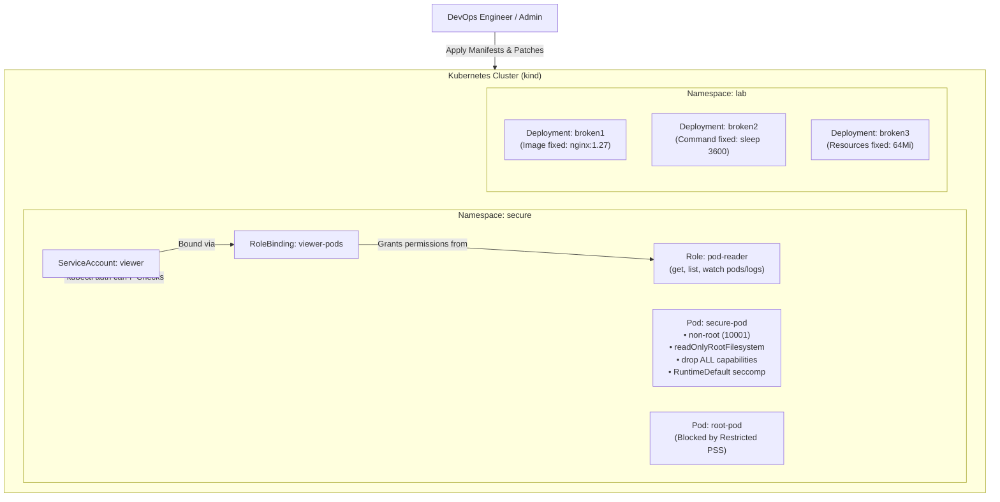
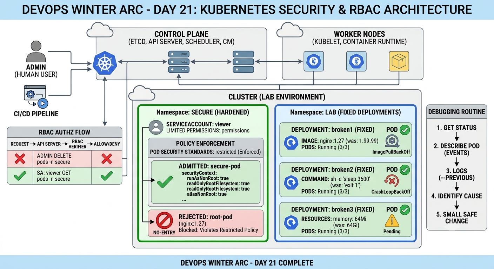

# Day 21: Kubernetes Security, RBAC & Troubleshooting

This repository contains the complete lab setup, security enforcement configurations, troubleshooting logs, and evidence for the **Day 21 Kubernetes Security, RBAC & Troubleshooting** task under the DevOps Winter Arc Challenge.

---

## 1. Repository Structure

```text
day21-security-debug/
├── README.md              # Main project documentation and lab evidence
├── rbac.yaml              # Role & RoleBinding definition for read-only access
└── secure-pod.yaml        # Hardened Pod manifest complying with Restricted PSS
└── screenshots 
 └── task-1.png 
 └── task-2-1.png 
 └── task-2-2.png
 └── task-3-1.png
 └── task-3-2.png
 └── task-3-3.png
 └── task-3-4.png
 └── task-3-5.png
```

---

## 2. Architecture Diagram

### System Architecture (Mermaid)



### Architecture Diagram


---

## 3. RBAC Verification Results

Permissions were validated using `kubectl auth can-i` impersonating the `viewer` ServiceAccount:

```bash
# Check read access to pods in 'secure' namespace
kubectl auth can-i get pods -n secure --as=system:serviceaccount:secure:viewer
# Output: yes

# Check pod deletion access in 'secure' namespace
kubectl auth can-i delete pods -n secure --as=system:serviceaccount:secure:viewer
# Output: no
```

---

## 4. Pod Security Standard (PSS) Rejection Evidence

The `secure` namespace was configured with the **Restricted** Pod Security profile:

```bash
kubectl label namespace secure pod-security.kubernetes.io/enforce=restricted
```

When attempting to launch an unhardened, root-based container:

```bash
kubectl run root-pod --image=nginx:1.27 -n secure
```

**Cluster Rejection Output:**

```text
Error from server (Forbidden): pods "root-pod" is forbidden: violates PodSecurity "restricted:latest": 
allowPrivilegeEscalation != false (container "root-pod" must set securityContext.allowPrivilegeEscalation=false), 
unrestricted capabilities (container "root-pod" must set securityContext.capabilities.drop=["ALL"]), 
runAsNonRoot != true (pod or container "root-pod" must set securityContext.runAsNonRoot=true), 
seccompProfile (pod or container "root-pod" must set securityContext.seccompProfile.type to "RuntimeDefault" or "Localhost")
```

---

## 5. Repeatable Debug Routine

Standard diagnostic steps for troubleshooting Kubernetes workloads:

1. **`get`**: Retrieve high-level workload state (`kubectl get deployments,pods -n <namespace>`).
2. **`describe`**: Inspect object metadata, scheduling conditions, and event logs (`kubectl describe pod <pod-name> -n <namespace>`).
3. **`logs`**: Examine stdout/stderr output (`kubectl logs <pod-name> -n <namespace> --previous`).
4. **`events`**: Review cluster events in chronological order (`kubectl get events -n <namespace> --sort-by=.lastTimestamp`).
5. **`exec`**: Interactively debug inside running pods if required (`kubectl exec -it <pod-name> -n <namespace> -- /bin/sh`).

---

## 6. Debug Notes Table

| Deployment | Symptom / Evidence | Root Cause | Fix Direction / Command Executed | Final Status |
| :--- | :--- | :--- | :--- | :--- |
| **`broken1`** | `ErrImagePull` / `ImagePullBackOff` | Non-existent image tag `nginx:1.99.99` | Updated image tag:<br>`kubectl set image deployment/broken1 -n lab nginx=nginx:1.27` | **Running (1/1)** |
| **`broken2`** | `CrashLoopBackOff` / `Error` | Container command set to `sh -c "exit 1"`, terminating immediately | Updated container command to long-running process:<br>`kubectl patch deployment broken2 -n lab --type=strategic -p '{"spec":{"template":{"spec":{"containers":[{"name":"busybox","command":["sleep"],"args":["3600"]}]}}}}'` | **Running (1/1)** |
| **`broken3`** | `Pending` | Unrealistic memory request (`64Gi`) exceeding total node capacity | Lowered resource memory request:<br>`kubectl set resources deployment/broken3 -n lab --requests=memory=64Mi` | **Running (1/1)** |

---

## 7. Final Verification

```bash
kubectl get pods -n lab
```

**Output:**

```text
NAME                        READY   STATUS    RESTARTS   AGE
broken1-676db6584f-xkkl5    1/1     Running   0          15m
broken2-7b55b99898-szvvj    1/1     Running   0          1m
broken3-75dfd4dc58-c4fzs    1/1     Running   0          5m
```